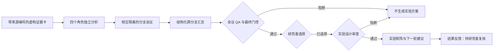

# AI-Co-Scientist：证据门控的科研多智能体协作演示

这是一个**脱敏的架构演示版**。以虚构的 HMFOR 研究规划案例，展示角色独立分析、分支会议、跨分支汇总、质量门控、研究者选择和下一轮实验建议如何衔接。仓库不包含真实论文库、实验记录、催化剂组成、机制主张或原项目提示词。

仓库中的案例均为**虚构数据回放**。可选的模型接口可以生成角色发言草案，但草案仍须核对来源并由研究者选择候选方案。软件门控通过只说明流程契约得到满足，**不代表科学结论已成立，也不授权直接开展实体实验**。

## 工作流程



四个角色是 `PI`、`Critic`、`SynthesisAssistant` 和 `CharacterizationAssistant`。使用模型生成时，各角色先独立提交会前报告；随后每个分支分别进行五轮发言：PI 开场、其余三个角色各发言一次、PI 裁决。分支之间不共享会议对话。仓库内的虚构案例按同一结构离线回放，无需调用 API。

## 复现两个案例

需要 Python 3.9 或更高版本。

```bash
python -m pip install -e .
python -m unittest discover -s tests -v
python -m co_scientist_demo --case examples/pass.json --out demo_out/pass
python -m co_scientist_demo --case examples/blocked.json --out demo_out/blocked
```

第一个案例输出 `COMPILED`；第二个案例模拟分支 fallback，输出 `BLOCKED`。可对比两次运行生成的 `RunStatus.json`、`Meeting_QA.json` 和 `DecisionTrace.json`。只有通过门控的案例会生成 `ExperimentMatrix.json` 与 `NextRoundAdvice.json`。每次运行请使用新的输出目录，程序会拒绝覆盖已有产物。

## 可选：生成实时角色草案

安装可选依赖，在本机环境中设置 `OPENAI_API_KEY` 和 `OPENAI_MODEL`，然后生成**未经审核的草案**：

```bash
python -m pip install -e ".[live]"
python -m co_scientist_demo --live-scenario examples/live_scenario.json --out demo_out/live_draft.json
```

这条命令只生成 `DemoCase` 草案，不会自动选择候选方案。核对来源和模型输出后，研究者可按需填写 `researcher_selected_candidate_id`，再用 `--case` 回放审查与交接流程。当前仓库没有真实 API 运行记录，也不宣称模型输出经过科学验证。

## 主要产物

| 文件 | 作用 |
| --- | --- |
| `EvidenceCards.json` | 带稳定编号和来源定位的虚构输入证据 |
| `PreMeetingReports.json`、`BranchArtifacts.json` | 角色独立报告和分支会议草案 |
| `MeetingSynthesis.json`、`Meeting_QA.json` | 共识、争议、否决理由、未决问题及门控结果 |
| `ExperimentDesignReview.json` | 检查对照、测量指标、判定规则和证据依据 |
| `ExperimentMatrix.json`、`NextRoundAdvice.json` | 已选候选方案的条件性比较计划 |
| `ResultFeedback.json` | 保留待研究者复核的虚构结果 |
| `RunStatus.json`、`DecisionTrace.json` | 可机读的运行状态和决策来源边界 |

会议发言不能直接新增或升级 `EvidenceCard`。来源编号无效、角色缺席、分支 fallback 或已选方案设计不完整，都会阻断后续产物；没有研究者选择时，流程停在 `AWAITING_SELECTION`。

阶段契约和测试范围见[架构与验收说明](docs/ARCHITECTURE.md)。
